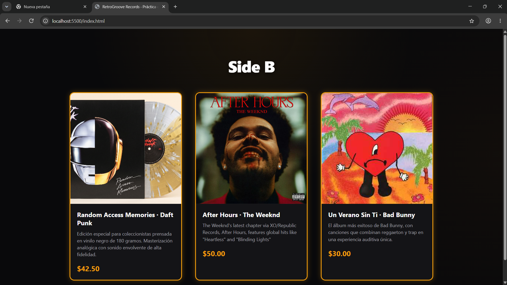
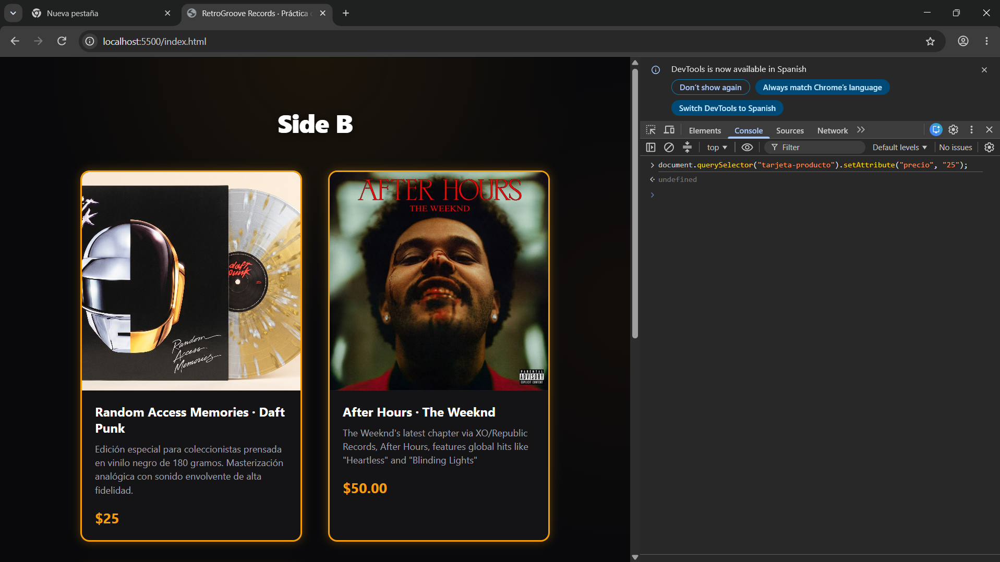

# Práctica de laboratorio · `<tarjeta-producto>`

Programación Integrativa de Componentes Web · Unidad 1: Web Components

| Dato | Completa |
|---|---|
| Emprendimiento | Side B (Venta de Discos de Vinilo) |
| Estudiantes (Apellido Nombre) | Jhaldry Peñaherrera, Diego Pinto, Israel Segovia, Santiago Nogales |
| NRC | 36642 |
| Fecha | Octubre 2026 |
| Enlace del repositorio | https://github.com/SantyRojas-2005/Web-Components-Grupo3.git |

## Propuesta del emprendimiento

- Nombre del emprendimiento: Side B
- Problema que resuelve: En la era de la música digital por streaming, se ha perdido la calidez acústica del audio analógico y el valor tangible de coleccionar arte en gran formato. Side B facilita el acceso a ediciones exclusivas y reediciones en vinilo de 180 gramos para disfrutar de una reproducción fiel y de alta calidad sonora.
- Cliente al que se dirige: Coleccionistas de música, audiófilos, personas aficionadas al formato físico y jóvenes interesados en la cultura del vinilo y el sonido analógico.

## Cómo abrir el proyecto

1. Abre la carpeta en Visual Studio Code.
2. Clic derecho sobre `index.html` → **Open with Live Server**. Los módulos no cargan con `file://`.
3. Abre las herramientas del navegador (F12) y deja visible la pestaña **Consola**.

## Registro de los pasos

### Paso 1 · index.html y el módulo

- Etiqueta que registramos: `<tarjeta-producto>`
- ¿Por qué el nombre debe llevar guion?: La especificación estándar de Custom Elements del W3C exige obligatoriamente incluir un guion (`-`) para evitar colisiones con elementos nativos de HTML actuales y futuros (como `div`, `span`, etc.).
- Ruta del módulo y cómo lo importa la página: Se ubica en `./componentes/tarjeta-producto.js` y se importa en el `<head>` de `index.html` mediante `<script type="module" src="./componentes/tarjeta-producto.js"></script>`.

### Paso 2 · Plantilla, Shadow DOM y slots

- Slots con nombre que tiene la plantilla: `slot="foto"` (para la imagen del vinilo) y `slot="nombre"` (para el título del álbum/artista).
- Texto de respaldo del slot sin nombre: `Sin descripción`
- ¿Qué pasaría si no usáramos `cloneNode(true)`?: Si no se clona, el contenido de la plantilla se movería físicamente al Shadow DOM de la primera tarjeta, vaciando la plantilla original. Por ende, las siguientes tarjetas quedarían completamente vacías. `cloneNode(true)` garantiza que cada instancia reciba una copia independiente y completa.

### Paso 3 · Atributo precio y estilos

- Método que reacciona cuando cambia `precio`: `attributeChangedCallback(nombre, anterior, valor)`
- Color de marca (`--color-marca`) y dónde lo definimos: `#f59e0b` (ámbar vintage). Lo definimos en `estilos.css` bajo el selector `tarjeta-producto { --color-marca: #f59e0b; }`.
- Valor de respaldo que usa el componente si la página no define la variable: `#d97706`, definido dentro de la plantilla con `var(--color-marca, #d97706)`.

### Paso 4 · Tres productos del emprendimiento

| # | Producto | Precio |
|---|---|---|
| 1 | Random Access Memories · Daft Punk | 42.50 |
| 2 | After Hours · The Weeknd | 50.00 |
| 3 | Un Verano Sin Ti · Bad Bunny | 30.00 |
| 4 | *(Pendiente: Vinilo de Santiago)* | *(Precio)* |

### Paso 5 · Repositorio del equipo

| Integrante | Qué hizo en este laboratorio |
|---|---|
| Jhaldry Peñaherrera | Creó el módulo `tarjeta-producto.js`, estructura de template, shadow DOM, slots, propiedad/atributo precio, estilos y tarjeta de Daft Punk en la rama `feature/jhaldry`. |
| Diego Pinto | Creó la rama `feature/diego`, agregó portada `AfterHours.jpg` e implementó tarjeta de The Weeknd. |
| Israel Segovia | Creó la rama `feature/israel`, agregó portada `unveranosinti.jpg` e implementó tarjeta de Bad Bunny. |
| Santiago Rojas | *(Pendiente: Rama `feature/santiago`, portada y tarjeta en `index.html`)* |

## Verificación

Marca con una `x` lo que ya comprobaste en el navegador.

- [x] La etiqueta tiene guion.
- [x] La página solo cambia lo que el componente expone con `var()`.
- [x] `setAttribute` cambia el precio en pantalla.
- [x] La consola no muestra errores.

Prueba que usamos en la consola:

```js
document.querySelector("tarjeta-producto").setAttribute("precio", "25");
```

Resultado que vimos:
El precio del componente en pantalla se actualizó de inmediato a 25 sin necesidad de recargar la página, confirmando la reactividad de `attributeChangedCallback`.

| Antes de la prueba | Después del cambio a precio="25" |
| :---: | :---: |
|  |  |

## Reto extra (opcional)

- [x] Atributo `destacado` que cambia el borde con `:host([destacado])`.

## Uso de inteligencia artificial

- Herramienta usada (o «ninguna»): Antigravity AI
- Para qué la consultamos: Para estructurar el esqueleto del Web Component según estándares W3C, revisar el ciclo de vida de Custom Elements (`connectedCallback` y `attributeChangedCallback`) y coordinar el flujo de ramas de Git.
- Qué cambiamos o comprobamos nosotros: Comprobamos el renderizado de los slots en el navegador, añadimos los discos y descripciones reales del equipo, personalizamos los estilos y realizamos las pruebas de consola con `setAttribute`.
